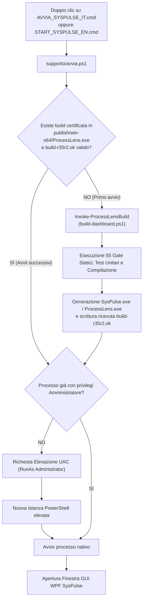

# SysPulse (R35 R2) — Analizzatore Avanzato di Processi, Memoria e Rete Windows

[](#) [](README.md)
[-blue.svg)](#requisiti-di-sistema-e-prerequisiti)
[](https://dotnet.microsoft.com/download/dotnet/8.0)
[](#principi-architetturali-e-sicurezza)
[](#pipeline-di-compilazione-dettagliata-fasi-1-6)
[](https://github.com/Buconero03/SysPulse/releases/tag/v1.0.0)
[](LICENSE)

*Disponibile anche in: [English](README.md) | [Italiano](README.it.md) | [Enciclopedia Analisi dei Processi Bilingue (IT + EN)](PROCESS_ANALYSIS_IT_EN.md)*

---

## Dimostrazione Pratica dell'Applicazione


*Figura 1: SysPulse R35 R2 in esecuzione su Windows 11. La telemetria mostra in tempo reale la % CPU per processo, il Working Set Privato e la velocità I/O di Rete. Il pannello di ispezione offre approfondimenti comportamentali e opzioni diagnostiche strutturate.*

---

**SysPulse** è una dashboard avanzata di telemetria di sistema, monitoraggio dei processi e analisi della rete per ambienti Windows a 64 bit. Progettata per garantire chiarezza, rigore strutturale e affidabilità, SysPulse offre **telemetria in tempo reale ad alta risoluzione**, **analisi comportamentale approfondita dei processi** e un'architettura di **osservazione trasparente e non invasiva**.

SysPulse monitora i carichi di sistema utilizzando esclusivamente API documentate del sistema operativo Windows: non inietta DLL nei processi utente, non installa driver filtro di terze parti (come WinPcap o Npcap) e non esegue agganci (hook) alle chiamate di sistema del kernel. Inoltre, distingue rigorosamente tra **dati osservati direttamente da Windows**, **fatti strutturali** e **inferenze probabilistiche**.

> [!NOTE]
> **Osservazione vs Azioni Amministrative**: Mentre la raccolta della telemetria e l'interrogazione dei processi operano rigorosamente in modalità non invasiva e in sola lettura, determinate azioni amministrative esplicite—nello specifico **Termina processo**, **Arresta servizio**, **Esegui nuova attività** o la generazione on-demand di **Dump della memoria Heap**—modificano intenzionalmente lo stato del sistema solo su esplicita richiesta e conferma dell'utente con privilegi elevati.

---

## Indice

1. [Panoramica e Caratteristiche Principali](#panoramica-e-caratteristiche-principali)
2. [Principi Architetturali e Sicurezza](#principi-architetturali-e-sicurezza)
3. [Struttura della Soluzione e Componenti](#struttura-della-soluzione-e-componenti)
4. [Come si Avvia: Procedura ed Esecuzione](#come-si-avvia-procedura-ed-esecuzione)
5. [Cosa Succede Durante l'Avvio (Processi e Fasi)](#cosa-succede-durante-lavvio-processi-e-fasi)
6. [Pipeline di Compilazione Dettagliata (Fasi 1-6)](#pipeline-di-compilazione-dettagliata-fasi-1-6)
7. [Tempi di Compilazione e Avvio](#tempi-di-compilazione-e-avvio)
8. [Architettura a Runtime: Come Lavora l'Applicazione](#architettura-a-runtime-come-lavora-lapplicazione)
   - [Gestione della Rete in Tempo Reale](#gestione-della-rete-in-tempo-reale)
   - [Pipeline di Risoluzione Icone e Glifi Vettoriali](#pipeline-di-risoluzione-icone-e-glifi-vettoriali)
   - [Memoria: Working Set Privato vs Totale](#memoria-working-set-privato-vs-totale)
   - [Ciclo di Vita della Finestra e Area di Notifica](#ciclo-di-vita-della-finestra-e-area-di-notifica)
9. [Requisiti di Sistema e Prerequisiti](#requisiti-di-sistema-e-prerequisiti)
10. [Risoluzione dei Problemi (Troubleshooting)](#risoluzione-dei-problemi-troubleshooting)
11. [Licenza e Note Legali](#licenza-e-note-legali)

---

## Panoramica e Caratteristiche Principali

SysPulse fornisce una visibilità granulare sui processi in esecuzione in ambiente Windows, aggregando telemetria avanzata in un'interfaccia moderna e reattiva in WPF:

- **Sistema Bilingue Unificato Nativo (Italiano / Inglese)**:
  Scelta immediata all'avvio con script dedicati (`AVVIA_SYSPULSE_IT.cmd`, `START_SYSPULSE_EN.cmd`) oppure tramite selezione iniziale (`AVVIA_PROCESSLENS.cmd`). Commutazione dinamica istantanea in qualsiasi momento dal pulsante nella barra superiore (**Lingua: IT / Language: EN**).
- **Monitoraggio Rete Live per PID e Gruppo**:
  Misurazione istantanea del throughput di invio e ricezione (`KB/s`, `MB/s`), byte cumulativi trasferiti e conteggio dei socket attivi (TCP in ascolto, connessioni TCP stabilite, porte UDP aperte). Ordinamento nativo delle righe per consumo di banda (`Rete`).
- **Sistema Icone Intelligente a 4 Livelli (Zero Icone Generiche Sgradevoli)**:
  Risoluzione multistadio che elimina i placeholder generici o a blocchi pixelati:
  1. Estrazione icone ad alta risoluzione dagli eseguibili nativi (PE `.ico`).
  2. Parsing automatico di `AppxManifest.xml` e recupero dei loghi PNG ufficiali per le app moderne di Windows Store / UWP.
  3. Ereditarietà semantica dell'icona per processi secondari, helper e worker (che ereditano l'icona dell'eseguibile primario nella medesima directory o dal genitore).
  4. Mappatura contestuale per i servizi ospitati da `svchost.exe`.
  5. Generatore di simboli vettoriali nitidi e moderni, basati su palette semantiche legate al ruolo applicativo e pattern hash stabili.
- **Ispezione Approfondita On-Demand (Deep Inspection)**:
  Nessuna scansione pesante di massa: i moduli DLL, i token di sicurezza, l'AUMID, i listener di rete e i thread vengono ispezionati dettagliatamente solo al momento della selezione del processo da parte dell'utente.
- **Tracciamento Distinto della Memoria**:
  Separazione categorica tra memoria fisica residente ad uso esclusivo del processo (*Private Working Set*) e memoria condivisa (*Working Set* totale), integrata con la rilevazione della pressione globale di memoria tramite `GlobalMemoryStatusEx`.
- **Minimizzazione a Basso Overhead nell'Area di Notifica**:
  Minimizzazione nella barra di sistema accanto all'orologio, con sospensione automatica dei timer di polling periodici per contenere il carico su CPU e memoria in background.

---

## Principi Architetturali e Sicurezza

```
┌────────────────────────────────────────────────────────────────────────┐
│                          PRINCIPI GUIDA                                │
├──────────────────────────┬─────────────────────────────────────────────┤
│ 1. Osservazione          │ Nessun driver di terze parti installato.    │
│    Non-Invasiva          │ Nessun aggancio (hook) a processi terzi.    │
│                          │ Chiamate documentate Win32 / IP Helper.     │
├──────────────────────────┼─────────────────────────────────────────────┤
│ 2. Rigore delle Evidenze │ Separazione rigida fra:                     │
│                          │ • Dato grezzo (es. TCP socket aperto)       │
│                          │ • Inferenza (es. ruolo di Server Web)       │
│                          │ • Stima (es. percentuale di carico)         │
├──────────────────────────┼─────────────────────────────────────────────┤
│ 3. Azioni Amministrative │ Modifiche esplicite (kill processo, arresto │
│    Esplicite             │ servizio, nuova attività, dump memoria) con │
│                          │ consenso ed elevazione esplicita.           │
├──────────────────────────┼─────────────────────────────────────────────┤
│ 4. Disciplina di Carico  │ Snapshot globale leggero.                   │
│                          │ Ispezione approfondita solo on-demand.      │
│                          │ Sospensione del polling ad alta frequenza   │
│                          │ quando ridotta a icona.                     │
└──────────────────────────┴─────────────────────────────────────────────┘
```

1. **Accesso Non-Invasivo**:
   Il monitoraggio utilizza le API native di sistema (`OpenProcess` con diritti minimi `PROCESS_QUERY_LIMITED_INFORMATION`, `GetExtendedTcpTable`, `GetExtendedUdpTable`, `GetProcessMemoryInfo`). Nessun parametro di sistema o criterio di audit viene alterato durante il monitoraggio.
2. **Elevazione UAC Esplicita**:
   L'eseguibile include nel manifest nativo `requireAdministrator` per permettere la lettura dei contatori prestazionali e delle porte di rete di tutti i processi utente e di sistema senza errori di accesso negato.
3. **Controllo delle Azioni Modificanti**:
   Le funzionalità che modificano lo stato del sistema (terminazione di processi con `ProcessTerminator`, arresto di servizi con `ServiceStopController` e avvio di nuove attività con `NewTaskLauncher`) sono confinate e richiedono conferma esplicita dell'utente.
4. **Isolamento del Profiler**:
   Gli strumenti di dump della memoria e profiling .NET risiedono in binari completamente separati (`ProcessLens.Profiler.exe`), non partono mai automaticamente e richiedono l'esplicito consenso, con una soglia di sicurezza che blocca le operazioni se la RAM supera l'85%.

---

## Struttura della Soluzione e Componenti

Il codice sorgente è organizzato in una soluzione modulare in .NET 8 / C# 12:

```
SysPulse / ProcessLens-Leggero/
├── AVVIA_SYSPULSE_IT.cmd              # Script batch di avvio rapido in lingua Italiana
├── START_SYSPULSE_EN.cmd              # Script batch di avvio rapido in lingua Inglese
├── AVVIA_PROCESSLENS.cmd              # Script batch predefinito con selezione lingua
├── LEGGIMI.txt                        # Note sintetiche di avvio e revisione
├── README.md                          # Documentazione principale in lingua inglese (GitHub standard)
├── README.it.md                       # Documentazione completa in lingua italiana
├── LICENSE                            # Licenza Open Source MIT
├── docs/
│   └── images/
│       └── syspulse-dashboard.png     # Screenshot dimostrativo dell'interfaccia live
├── supporto/
│   ├── avvia.ps1                      # Orchestratore di avvio con supporto -Language (it/en)
│   └── build-r35r2.ok                 # Ricevuta di certificazione build completata
└── progetto/
    ├── build-dashboard.ps1            # Script maestro di verifica, test e compilazione
    ├── publish-release.ps1            # Pubblicazione binari Windows x64
    ├── localization-manifest.json     # Hash SHA-256 dei sorgenti e delle copie localizzate
    ├── tools/
    │   ├── refresh-localization.ps1   # Runner del generatore di localizzazione Roslyn
    │   └── LocalizationGenerator/     # Generatore AST C# e XAML bilingue
    ├── src/
    │   ├── ProcessLens.Core/          # Modelli immutabili, metriche live e astrazioni
    │   ├── ProcessLens.Windows/       # Interoperabilità Win32, IP Helper e raccoglitori
    │   ├── ProcessLens.Semantics/     # Riconoscimento framework, ruoli e cataloghi
    │   ├── ProcessLens.App/           # Interfaccia grafica WPF, viste, tray e icone
    │   ├── ProcessLens.Profiler/      # Tool autonomo di analisi memoria .NET
    │   ├── ProcessLens.MemoryAgent/   # Agente opzionale per soglie e alert RAM
    │   └── ProcessLens.RamMonitor/    # Monitor standalone di memoria
    ├── tests/                         # Suite di test automatizzati per ogni modulo
    ├── audit/                         # Strumenti di verifica statica e conformità (R10-R35 R2)
    └── publish/win-x64/               # Output finale compilato ed eseguibile (SysPulse.exe)
```

---

## Come si Avvia: Procedura ed Esecuzione



### Metodi di Avvio e Supporto Bilingue (Italiano / Inglese)

1. **Avvio Diretto in Lingua Italiana**:
   Doppio clic su `AVVIA_SYSPULSE_IT.cmd` nella cartella principale.
2. **Avvio Diretto in Lingua Inglese**:
   Doppio clic su `START_SYSPULSE_EN.cmd` nella cartella principale.
3. **Avvio Interattivo con Scelta Lingua**:
   Doppio clic su `AVVIA_PROCESSLENS.cmd` nella cartella principale per scegliere la lingua prima dell'apertura.
4. **Da PowerShell con parametro lingua esplicito**:
   ```powershell
   # Per avviare in Italiano:
   .\supporto\avvia.ps1 -Language it

   # Per avviare in Inglese:
   .\supporto\avvia.ps1 -Language en
   ```
5. **Cambio Lingua Dinamico dall'Interfaccia Grafica**:
   Nella barra superiore dell'applicazione è presente il pulsante interattivo **Lingua: IT / Language: EN** che consente di commutare istantaneamente tutte le etichette, colonne, dettagli e descrizioni dei processi tra Italiano e Inglese senza riavviare. La scelta viene salvata e ricordata automaticamente.
6. **Esecuzione Diretta del Binario Compilato**:
   ```cmd
   .\progetto\publish\win-x64\SysPulse.exe --lang it
   ```

---

## Cosa Succede Durante l'Avvio (Processi e Fasi)

1. **Inizializzazione e Pre-Flight (`supporto\avvia.ps1`)**:
   Lo script verifica la piattaforma Windows e controlla la presenza dell'ambiente .NET 8 (Desktop Runtime / SDK). Se presente una cartella runtime offline locale, la riutilizza in totale isolamento.
2. **Risoluzione della Ricevuta di Build (`build-r35r2.ok`)**:
   Se il binario e la firma `ProcessLens-R35-R2-wpf-inheritance` sono già presenti, la compilazione viene saltata e l'avvio richiede **meno di 1 secondo**.
3. **Elevazione dei Privilegi UAC**:
   Se il processo non dispone dei diritti di amministratore, richiede automaticamente l'elevazione tramite `RunAs`.
4. **Avvio dell'Applicazione GUI**:
   Avvio del processo, registrazione hook messaggi di finestra, inizializzazione tray icon (`Shell_NotifyIconW`), aggancio timer periodici di campionamento (intervalli 1-2s) e caricamento snapshot iniziale dei processi.

---

## Pipeline di Compilazione Dettagliata (Fasi 1-6)

Lo script `progetto/build-dashboard.ps1` include:
- **FASE 1: 55 Controlli Statici PowerShell e Audit**:
  - Verifica della sintassi PowerShell su tutti i 113 script.
  - Verifica hash del manifesto di localizzazione R35 (`check-localization-r35.ps1`).
  - Verifica coerenza classi base e radici XAML localizzate (`check-localized-window-r35r2.ps1`).
  - Controlli su leggibilità UI, sicurezza dei menu XAML, isolamento del profiler e vincoli architetturali.
- **FASE 2: Suite di Test Automatizzati**:
  - `LocalizationTests`: 372 verifiche di conformità del dizionario e integrità dei dati originali.
  - `LocalizationUiTests`: test headless sui tipi di finestra localizzati.
  - Test su diagnostica JSONL, SQLite sola lettura, soglie memoria 85/80, intervalli CPU, metriche live RAM e socket TCP/UDP, filtri identità, 61 icone catalogo, test headless WPF e shell smoke test reale `MainWindowSmoke`.
- **FASI 3 & 4: Profiler e Fixture**: compilazione fixture sintetica e profiler autonomo isolato.
- **FASE 5: Build Principale**: compilazione Release WPF con convalida XAML.
- **FASE 6: Pubblicazione Windows x64**: pubblicazione eseguibili nativi in `publish/win-x64/` (con generazione di `SysPulse.exe` e `ProcessLens.exe`) e marcatura della ricevuta `supporto/build-r35r2.ok`.

---

## Tempi di Compilazione e Avvio

| Scenario di Esecuzione | Tempo Stimato | Dettaglio Operazioni |
| :--- | :--- | :--- |
| **Avvio Diretto (già compilato)** | **< 1 secondo** | Esecuzione immediata dell'eseguibile nativo `SysPulse.exe` tramite `supporto/avvia.ps1`. |
| **Compilazione Incrementale (`dotnet build`)** | **~3 - 5 secondi** | Ricompilazione rapida dei soli assembly modificati (Core, Windows, App). |
| **Pipeline di Build e Validazione Completa** | **~60 - 90 secondi** | Esecuzione completa di tutti i 55 audit statici, controlli di localizzazione R35, suite di test unitari, test WPF headless, fixture di finestra reale `MainWindowSmoke` e pubblicazione dei binari. |

---

## Architettura a Runtime: Come Lavora l'Applicazione

### Gestione della Rete in Tempo Reale
- Query a basso overhead alle tabelle di connessione TCP/UDP (`GetExtendedTcpTable`, `GetExtendedUdpTable`).
- Calcolo in tempo reale del throughput di invio/ricezione e byte trasferiti tramite `IO_COUNTERS`.
- Ordinamento dinamico per consumo di rete (`Rete`) e tracciamento socket aperti.

### Pipeline di Risoluzione Icone e Glifi Vettoriali
1. **Icona Nativa PE**: estrazione della risorsa `.ico` incorporata nell'eseguibile.
2. **Appx / Windows Store (UWP)**: lettura di `AppxManifest.xml` e recupero del logo PNG ufficiale ad alta definizione.
3. **Ereditarietà per Sottoprocessi Helper**: i processi secondari privi di icona ereditano l'icona dell'eseguibile primario nella medesima cartella o dal genitore.
4. **Glifi Vettoriali Semantici**: generazione procedurale di simboli geometrici nitidi da catalogo semantico (61 categorie, oltre 480 binari mappati), congelati in memoria senza alcuna icona sgradevole o a blocchi.

### Memoria: Working Set Privato vs Totale
- Distinzione tra Private Working Set (RAM fisica esclusiva) e Working Set totale (inclusa memoria condivisa).
- Adattamento automatico della frequenza di polling tramite `GlobalMemoryStatusEx`.

### Ciclo di Vita della Finestra e Area di Notifica
- Riduzione nell'area di notifica con sospensione dei timer periodici per contenere l'uso della CPU in background.
- Ripristino con singolo clic e supporto per riavvio di Windows Explorer (`TaskbarCreated`).

---

## Requisiti di Sistema e Prerequisiti

- **Sistema Operativo**: Windows 10 (versione 1809 o successiva) o Windows 11 a 64 bit (x64).
- **Ambiente .NET**: .NET 8.0 Desktop Runtime (x64) per l'esecuzione; .NET 8.0 SDK (x64) per la compilazione.
- **Privilegi**: Amministratore (richiesta UAC) per l'accesso alle metriche di rete e contatori globali.
- **Dipendenze Esterne**: Nessuna (zero driver, zero pacchetti esterni non inclusi).

---

## Licenza e Note Legali

SysPulse è rilasciato come software open source sotto i termini della [Licenza MIT](LICENSE).

Tutti i marchi, loghi ed elementi grafici di Windows appartengono a Microsoft Corporation. SysPulse interagisce esclusivamente tramite le API documentate del sistema operativo Windows nel pieno rispetto delle linee guida di sicurezza della piattaforma.
