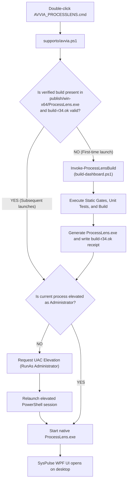
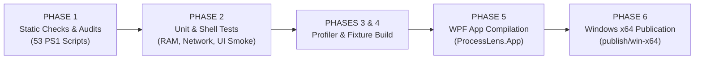
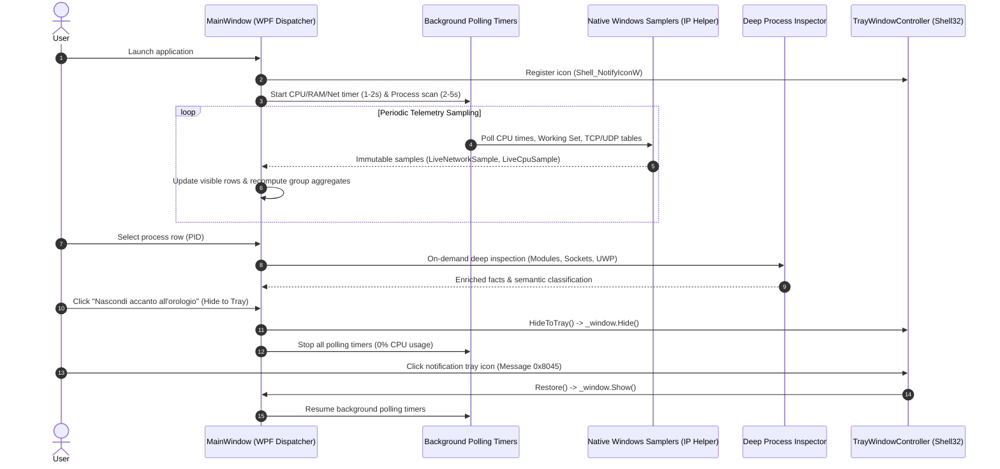

# SysPulse (ProcessLens R34) — Advanced Windows Process, Memory & Network Inspector

[](#) [](README.it.md)
[-blue.svg)](#system-requirements)
[](https://dotnet.microsoft.com/download/dotnet/8.0)
[](#architectural-principles--safety)
[](#compilation-pipeline-phases-1-6)

*Read this in other languages: [English](README.md) | [Italiano](README.it.md)*

**SysPulse** is an advanced systems analysis dashboard and high-precision Task Manager & Network Inspector for 64-bit Windows environments. Engineered on the battle-tested ProcessLens R34 engine, SysPulse is purpose-built to deliver **absolute transparency**, **microsecond-accurate live telemetry**, and a **zero-intervention architecture**.

Unlike commercial task managers and aggressive observability tools, SysPulse operates in **strict read-only mode**: it never injects DLLs into user processes, never installs third-party filter drivers (such as WinPcap or Npcap), never hooks kernel system calls, and systematically differentiates between **direct Windows observations**, **probabilistic inferences**, and **heuristic estimates**.

---

## Table of Contents

1. [Overview and Key Features](#overview-and-key-features)
2. [Architectural Principles & Safety](#architectural-principles--safety)
3. [Solution Architecture & Components](#solution-architecture--components)
4. [How to Run: Launching the Application](#how-to-run-launching-the-application)
5. [What Happens During Startup (Processes & Lifecycle)](#what-happens-during-startup-processes--lifecycle)
6. [Compilation Pipeline (Phases 1-6)](#compilation-pipeline-phases-1-6)
7. [Compilation & Startup Durations](#compilation--startup-durations)
8. [Runtime Architecture: How SysPulse Operates](#runtime-architecture-how-syspulse-operates)
   - [Real-Time Network Monitoring & Sockets](#real-time-network-monitoring--sockets)
   - [4-Tier Process Icon Resolution (Zero Ugly Default Icons)](#4-tier-process-icon-resolution-zero-ugly-default-icons)
   - [Memory Analytics: Private Working Set vs Total](#memory-analytics-private-working-set-vs-total)
   - [Window Lifecycle & System Notification Tray](#window-lifecycle--system-notification-tray)
9. [System Requirements](#system-requirements)
10. [Troubleshooting](#troubleshooting)
11. [License & Disclaimers](#license--disclaimers)

---

## Overview and Key Features

SysPulse provides granular visibility into all running processes on Windows, consolidating live telemetry into a modern, responsive WPF desktop interface:

- **Live Network Monitoring per Process and Application Group**:
  Real-time inbound and outbound throughput measurement (`KB/s`, `MB/s`), cumulative transferred bytes, and active socket enumeration (listening TCP ports, established TCP connections, open UDP endpoints). Built-in column sorting by bandwidth consumption (`Network` / `Rete`).
- **Smart 4-Tier Icon Resolver (Zero Generic Default Placeholders)**:
  Eliminates default square or blocky pixel grids through an intelligent multi-stage resolver:
  1. High-resolution extraction from native Portable Executable (PE `.ico`) resources.
  2. Automatic `AppxManifest.xml` parsing and official PNG asset extraction for modern Microsoft Store / UWP packaged applications.
  3. Parent/sibling inheritance for background helpers, compile tools, and Chromium/Electron worker subprocesses.
  4. Contextual service mapping for multi-instance `svchost.exe` hosts.
  5. Clean, crisp semantic vector glyphs generated dynamically with hash-stable geometric accents based on role classification.
- **On-Demand Deep Inspection**:
  Protects system responsiveness by strictly avoiding global heavy scans. Modules, DLLs, security tokens, package identities (AUMID), network sockets, and execution threads are inspected deeply only when a process is selected by the user.
- **Accurate Physical Memory Metrics**:
  Rigorous distinction between process-exclusive physical memory (**Private Working Set**) and shared memory pages (**Working Set Total**), integrated with physical system memory pressure detection via `GlobalMemoryStatusEx`.
- **Zero-Footprint Tray Minimization**:
  Minimizes into the Windows Notification Area (system tray next to the clock), immediately halting high-frequency polling timers to guarantee zero background CPU overhead.

---

## Architectural Principles & Safety

```
┌────────────────────────────────────────────────────────────────────────┐
│                          GUIDING PRINCIPLES                            │
├──────────────────────────┬─────────────────────────────────────────────┤
│ 1. Zero-Intervention     │ No third-party drivers or kernel hooks.     │
│                          │ No DLL injection into external processes.   │
│                          │ Strictly documented Win32 & IP Helper APIs. │
├──────────────────────────┼─────────────────────────────────────────────┤
│ 2. Evidence Integrity    │ Uncompromising separation of:               │
│                          │ • Raw facts (e.g., open TCP listener)       │
│                          │ • Inferences (e.g., Web Server role)        │
│                          │ • Estimates (e.g., CPU load %)              │
├──────────────────────────┼─────────────────────────────────────────────┤
│ 3. Load Discipline       │ Global scan stays ultra-lightweight.        │
│                          │ Heavy deep inspection is strictly on-demand.│
│                          │ Immediate polling pause when minimized.     │
└──────────────────────────┴─────────────────────────────────────────────┘
```

1. **Non-Invasive Read-Only Execution**:
   Process queries use minimal access rights (`PROCESS_QUERY_LIMITED_INFORMATION`, `GetExtendedTcpTable`, `GetExtendedUdpTable`, `GetProcessMemoryInfo`). No system parameters, firewall rules, or audit settings are modified.
2. **Explicit Administrative Elevation**:
   The native assembly manifest declares `requireAdministrator`, ensuring Windows presents an explicit UAC prompt at launch so all network sockets and cross-session process metrics can be queried without access denials.
3. **Isolated Memory Profiler**:
   Heavy memory profiling and .NET GCDump inspection reside in completely decoupled standalone executables (`ProcessLens.Profiler.exe`). Profiling never starts automatically and incorporates safety gates that prevent execution if physical RAM usage exceeds 85%.

---

## Solution Architecture & Components

The solution is built on modern .NET 8 / C# 12 and WPF:

```
SysPulse / ProcessLens-Leggero/
├── START_SYSPULSE_EN.cmd              # Instant-launch batch script in English
├── AVVIA_SYSPULSE_IT.cmd              # Instant-launch batch script in Italian
├── AVVIA_PROCESSLENS.cmd              # Default instant-launch batch script
├── LEGGIMI.txt                        # Concise Italian launch and release notes
├── README.md                          # Full English documentation (GitHub root)
├── README.it.md                       # Full Italian documentation
├── supporto/
│   ├── avvia.ps1                      # Launch orchestrator with -Language support (en/it)
│   └── build-r34.ok                   # Signed build receipt for verified instant launch
└── progetto/
    ├── build-dashboard.ps1            # Master build, test, and audit script
    ├── publish-release.ps1            # Release compilation and artifact packager
    ├── src/
    │   ├── ProcessLens.Core/          # Immutable domain models, metrics, and contracts
    │   ├── ProcessLens.Windows/       # Win32 P/Invoke, IP Helper, and OS samplers
    │   ├── ProcessLens.Semantics/     # Process categorization, role inference & catalog
    │   ├── ProcessLens.App/           # WPF GUI, MVVM bindings, tray shell & icon resolver
    │   ├── ProcessLens.Profiler/      # Isolated on-demand .NET memory profiler
    │   ├── ProcessLens.MemoryAgent/   # Standalone memory alert service
    │   └── ProcessLens.RamMonitor/    # Dedicated lightweight RAM monitor
    ├── tests/                         # Full automated test suites across all layers
    ├── audit/                         # Static compliance, security & architectural gates
    └── publish/win-x64/               # Published production release binaries
```

### Module Responsibilities

- **`ProcessLens.Core`**:
  Defines immutable state snapshots (`ProcessSnapshot`, `ProcessGroupUsage`), live telemetry samples (`LiveNetworkSample`, `LiveCpuSample`, `LiveMemorySample`), and culture-invariant formatters.
- **`ProcessLens.Windows`**:
  Interfaces directly with the Windows kernel:
  - `WindowsLiveNetworkSampler.cs`: Queries TCP/UDP extended connection tables and process I/O counters.
  - `WindowsLiveCpuSampler.cs`: Derives high-precision CPU percentages from monotonic timestamps and `GetProcessTimes`.
  - `WindowsProcessCollector.cs`: Performs rapid, low-overhead sweeps of running processes.
  - `WindowsDeepProcessInspector.cs`: Inspects selected PID modules, tokens, threads, and network bindings.
- **`ProcessLens.Semantics`**:
  Analyzes command lines, loaded modules, Windows SCM services, and process tree topology to categorize processes (e.g., database, compiler, web browser renderer, IDE, system service).
- **`ProcessLens.App`**:
  The WPF presentation layer, featuring virtualized list views, split-pane inspection panels, system notification integration (`TrayWindowController.cs`), vector glyph rendering (`ProcessSymbolDrawing.cs`), and diagnostic logging.

---

## How to Run: Launching the Application



### Quick Launch Options & Dual-Language Mode

1. **English Mode Launch**:
   Double-click `START_SYSPULSE_EN.cmd` from the root folder, or run:
   ```powershell
   .\supporto\avvia.ps1 -Language en
   ```
2. **Italian Mode Launch**:
   Double-click `AVVIA_SYSPULSE_IT.cmd` (or `AVVIA_PROCESSLENS.cmd`) from the root folder, or run:
   ```powershell
   .\supporto\avvia.ps1 -Language it
   ```
3. **Dynamic Interactive Switching**:
   Click the **Language: EN / Lingua: IT** button situated directly in the top header bar of the application at any time to toggle between English and Italian on-the-fly. The selected language is automatically saved and remembered across sessions.
4. **Direct CLI Argument**:
   ```cmd
   .\progetto\publish\win-x64\ProcessLens.exe --lang en
   ```
3. **Manual Clean Build and Full Verification**:
   ```powershell
   cd .\progetto
   .\build-dashboard.ps1
   ```
4. **Direct Binary Execution (when pre-built)**:
   ```powershell
   .\progetto\publish\win-x64\ProcessLens.exe
   ```

---

## What Happens During Startup (Processes & Lifecycle)

When `AVVIA_PROCESSLENS.cmd` is executed, the following coordinated steps take place:

1. **Pre-Flight Environment Detection (`supporto\avvia.ps1`)**:
   - `AVVIA_PROCESSLENS.cmd` executes Windows PowerShell with `-NoLogo -NoProfile -ExecutionPolicy Bypass`.
   - `avvia.ps1` verifies the OS is `Windows_NT`.
   - Scans for an available .NET 8 Desktop Runtime and SDK:
     - Checks system-wide SDK installations.
     - Checks local private runtimes (e.g. `Programs/ProcessLens/R20/dotnet`) to enable 100% offline standalone operation without external downloads.
2. **Build Receipt Verification (`supporto/build-r34.ok`)**:
   - Checks if `progetto/publish/win-x64/ProcessLens.exe` exists and matches the receipt signature `ProcessLens-R34-network-clarity`.
   - **If valid**: Compilation is skipped entirely. Launch proceeds in **< 1 second**.
   - **If missing or outdated**: Involves `build-dashboard.ps1` to re-verify and compile.
3. **UAC Security Elevation**:
   - Checks user token role (`WindowsPrincipal.IsInRole(WindowsBuiltInRole.Administrator)`).
   - If unprivileged, requests elevation via Windows `RunAs`, spawning an elevated instance.
4. **WPF Application Bootstrap**:
   - Initializes internal diagnostics journal (`AppDiagnostics`).
   - Obtains native window handle (`HWND`) and registers message hooks (`HwndSource.AddHook`).
   - Configures the notification area icon via `Shell_NotifyIconW`.
   - Launches background polling timers for CPU, RAM, and Network metrics.
   - Collects initial snapshot and renders virtualized process cards.

---

## Compilation Pipeline (Phases 1-6)

Running `build-dashboard.ps1` executes an exhaustive automated gate consisting of 53 static checks and over 340 test assertions:



### Phase Breakdown

- **PHASE 1: Static Code Audits & Safety Rules**:
  - Validates AST syntax across all 106 PowerShell scripts in the repository.
  - Verifies XAML safety (no dynamic event handlers embedded inside Style setters).
  - Verifies profiler isolation (no unprompted memory dumps; 85% RAM guard rule).
  - Validates historical revision conformance gates (R8 through R34).
- **PHASE 2: Automated Unit, Integration & UI Tests**:
  - `DiagnosticsTests`: JSONL event structure and privacy redactions.
  - `GuardianDashboardTests`: Read-only SQLite query verification.
  - `MemoryAlertTests`: Memory threshold hysteresis policy (85% alert, 80% clear).
  - `CpuTests`: Monotonic time intervals and dual-sample delta math.
  - `LiveMetricsTests`: Working set calculations and socket counting.
  - `ProcessGroupsTests`: Group aggregation and identity filter matching.
  - `ProcessGroupsUiTests` & `MainWindowSmoke`: Real WPF `MainWindow` lifecycle, caption minimize, taskbar restoration, and Shell v4 notification packet routing.
  - `IconResourceTests`: Multi-resolution PNG icon resource extraction and 61-entry symbol catalog validation.
  - `NetworkUiTests` & `NativeNetworkTests`: Simulated socket state verification.
- **PHASES 3 & 4: Profiler & Fixture Build**:
  - Builds synthetic test fixture and independent on-demand profiler (`ProcessLens.Profiler.exe`).
- **PHASE 5: Main Application Build**:
  - Compiles `ProcessLens.App.csproj` in `Release` configuration and compiles XAML to BAML.
- **PHASE 6: Windows x64 Publication**:
  - Publishes ready-to-run binaries to `publish/win-x64/` and generates `supporto/build-r34.ok`.

---

## Compilation & Startup Durations

| Stage | Typical Duration | Description |
| :--- | :--- | :--- |
| **Instant Launch (Pre-Built)** | **< 1.0 second** | Immediate native launch of `ProcessLens.exe` via `AVVIA_PROCESSLENS.cmd`. |
| **Incremental Build (`dotnet build`)** | **~3 - 5 seconds** | Fast rebuild of modified assemblies during development. |
| **Full Build & Verification Pipeline** | **~60 - 90 seconds** | Complete execution of 53 static audits, 341 test assertions, WPF shell fixture, and multi-project release publication. |

---

## Runtime Architecture: How SysPulse Operates



---

### Real-Time Network Monitoring & Sockets

Implemented in `WindowsLiveNetworkSampler.cs`, the network pipeline is non-invasive:

1. **Extended Connection Tables**:
   Safe Win32 P/Invoke of `GetExtendedTcpTable` and `GetExtendedUdpTable` maps open endpoints to owning PIDs.
2. **Transfer Throughput Calculation**:
   Samples `IO_COUNTERS` on process handles with `PROCESS_QUERY_LIMITED_INFORMATION`:
   $$\text{Throughput} = \frac{\Delta \text{Bytes}}{\Delta t}$$
3. **Live GUI Binding & Sorting**:
   Formatted as readable units (`KB/s`, `MB/s`) with live connection counts. Clicking the **Network** sort header instantly surfaces top network consumers.

---

### 4-Tier Process Icon Resolution (Zero Ugly Default Icons)

Implemented in `ProcessIconResolver.cs`, ensuring every single process has a clear visual identity:

```text
[ Process Instance: ExecutablePath, ProcessName, CommandLine ]
                              │
             ┌────────────────▼───────────────┐
             │ 1. Native PE Executable Icon   │ ──(Found)───> [ BitmapSource ]
             └────────────────┬───────────────┘
                              │ Missing or generic
             ┌────────────────▼───────────────┐
             │ 2. AppxManifest.xml (UWP/Store)│ ──(Found)───> [ BitmapSource ]
             └────────────────┬───────────────┘
                              │ Missing
             ┌────────────────▼───────────────┐
             │ 3. Sibling / Parent App Icon   │ ──(Found)───> [ BitmapSource ]
             └────────────────┬───────────────┘
                              │ Missing
             ┌────────────────▼───────────────┐
             │ 4. Semantic Catalog & Vector   │ ──(Vector)──> [ Frozen DrawingImage ]
             │    Glyph (ProcessSymbols.json) │
             └────────────────────────────────┘
```

1. **Native PE Icon**: Extracts primary icon using `ExtractIconExW`.
2. **Appx / Windows Store (UWP)**: Parses `AppxManifest.xml` in package directory and loads official high-res PNG logos (e.g. `Square44x44Logo.png`).
3. **Helper / Sibling Inheritance**: Unadorned helper executables (e.g. Electron or browser renderers) inherit the branding of the parent application or main directory executable.
4. **Semantic Vector Glyphs**: For utility binaries without icons, `ProcessSymbolDrawing.cs` leverages `ProcessSymbols.json` (61 categories, 480+ mapped binaries) to render crisp, modern vector icons tinted according to their functional role and accented with hash-stable geometric markers.

---

### Memory Analytics: Private Working Set vs Total

- **Private Working Set**:
  Physical RAM held exclusively by the process. Cannot be shared with other processes; represents the true memory cost of running the executable.
- **Total Working Set**:
  Physical RAM including shared library pages mapped by multiple processes (e.g., system DLLs).
- **System-Wide Pressure Protection**:
  Monitors `GlobalMemoryStatusEx` and dynamically eases refresh intervals during severe memory pressure to prevent system stutter.

---

### Window Lifecycle & System Notification Tray

Managed by `TrayWindowController.cs`:

- **Standard Minimize**: Minimizes to the taskbar.
- **Hide to Tray**:
  Hides the window, clears taskbar presence, and immediately halts polling loops to guarantee zero CPU drain in background.
- **Restore**:
  Single-click or context menu activation restores the window to its exact previous state (Normal/Maximized).
- **Shell Recovery**:
  Listens for the `TaskbarCreated` message to cleanly re-register the tray icon if Windows Explorer crashes or restarts.

---

## System Requirements

- **Operating System**: Windows 10 (version 1809 or later) or Windows 11 (64-bit x64).
- **.NET Environment**:
  - **Running**: .NET 8.0 Desktop Runtime (x64) installed or local offline runtime bundle.
  - **Building**: .NET 8.0 SDK (x64).
- **Privileges**: Administrator privileges (UAC prompt) to query global process I/O and network endpoints.
- **Dependencies**: **Zero**. No external driver installations, WinPcap, or Npcap required.

---

## Troubleshooting

### Application does not open when clicking `AVVIA_PROCESSLENS.cmd`
- Ensure the archive is extracted into a standard user directory with write access (not inside `C:\Windows\System32`).
- Accept the Windows UAC confirmation dialog ("Do you want to allow this app to make changes?").
- Verify that .NET 8 Desktop Runtime is installed:
  ```cmd
  dotnet --list-runtimes
  ```
  Look for `Microsoft.WindowsDesktop.App 8.0.x`.

### Compilation fails running `build-dashboard.ps1`
- Confirm .NET 8 SDK is present:
  ```cmd
  dotnet --list-sdks
  ```
- Ensure PowerShell script execution is enabled:
  ```powershell
  Set-ExecutionPolicy -Scope Process -ExecutionPolicy Bypass
  ```
- Review the automated build journal at `%LOCALAPPDATA%\ProcessLens\logs\build.jsonl`.

---

## License & Disclaimers

SysPulse is open source under the terms of its repository license. Windows, Win32, WPF, and UWP are trademarks of Microsoft Corporation. SysPulse interacts exclusively through documented Windows operating system APIs in strict adherence to platform security guidelines.
